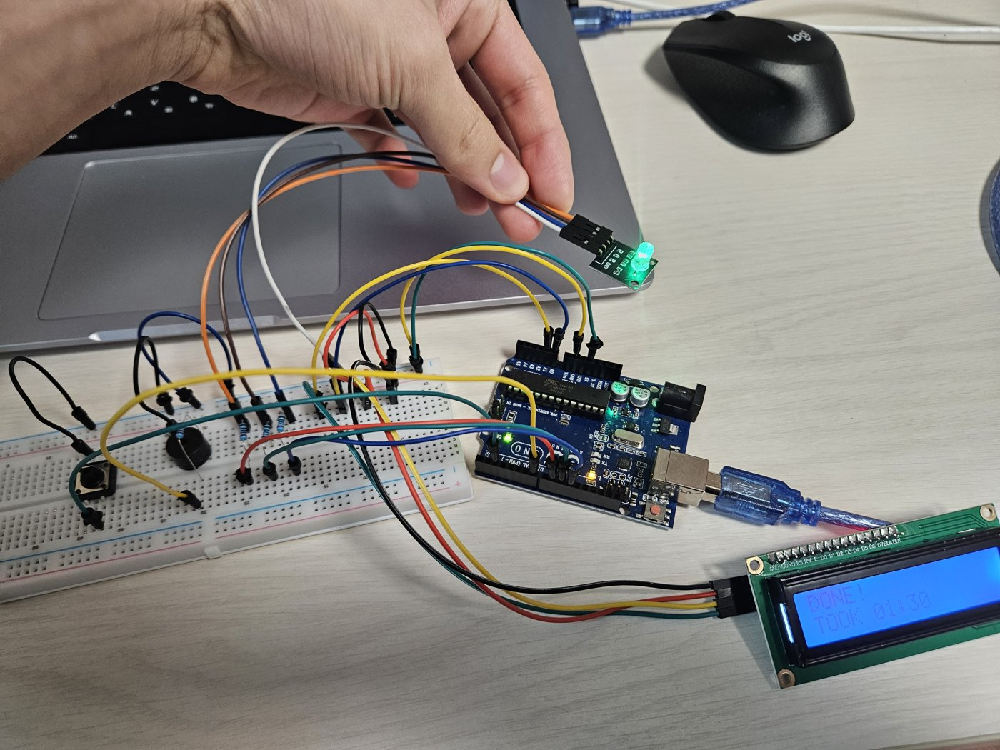
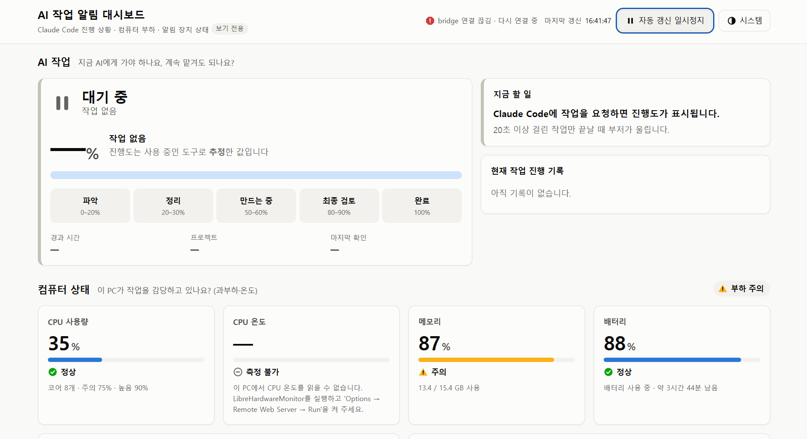
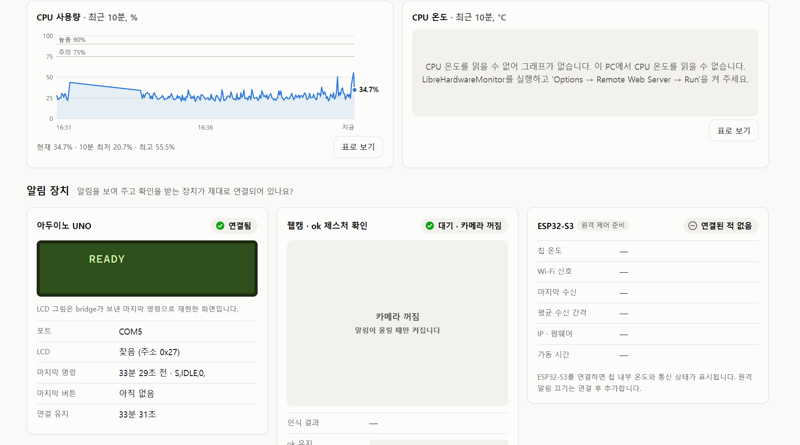

# AI 작업 알림 장치 (AI Agent Notifier)

Claude Code가 오래 걸리는 작업을 하는 동안 **진행 단계를 LCD·RGB 조명으로 보여주고**,
**완료되거나 내 답변이 필요하면 부저로 불러주며**, 내가 **웹캠에 `ok` 손 제스처를 보이거나 빵판 버튼을 누르면 알림을 멈추는** 장치입니다.
웹 대시보드는 같은 PC 브라우저에서 상태와 기록을 **보기 전용**으로 보여줍니다.



*작업이 끝나 LCD에 `DONE! TOOK 01:30`, RGB는 초록으로 켜진 모습*

## 아이디어

- Claude Code에게 명령을 주면 **현재 진행도를 LCD에 %로** 나타내고, **RGB 조명으로도 진행도를** 나타낸다.
- 부저를 연결해 **완료되면 부저를 울린다.** 답변을 기다릴 때와 완료됐을 때는 **부저 소리와 RGB 색을 다르게** 한다.
- **웹캠으로 사용자가 특정 제스처(`ok`)를 보이면 알림을 멈춘다.**
- **XIAO ESP32S3**를 연결해 **휴대폰에서 무선으로 진행 상황을 확인하고 부저를 끌 수 있게** 한다.
- 웹 대시보드는 학습한 대시보드 디자인 스킬을 활용해서 만든다.

## 전체 흐름

```
Claude Code ──(hooks)──▶ hooks/send_event.py ──HTTP──▶ bridge/ (Python, FastAPI)
                                                         │  ├─ 상태 판단(진행도·완료·답변대기)
                                                         │  ├─ 확인 감지(웹캠 ok 제스처 / 빵판 버튼)
                                                         │  └─ 기록 저장(data/notifier.db)
                                    USB 시리얼 ◀─────────┤
              arduino/notifier (UNO: LCD·RGB·부저·버튼)   ├─ WebSocket ──▶ dashboard/ (브라우저, 보기 전용)
                                                         └─ 같은 Wi-Fi ──▶ esp32/ (XIAO ESP32S3) ──▶ 휴대폰
```

## 웹 대시보드

| AI 작업 진행도 · 컴퓨터 상태 | 알림 장치 (UNO · 웹캠 · ESP32-S3) |
|---|---|
|  |  |

- **AI 작업**: 현재 단계(파악 → 정리 → 만드는 중 → 최종 검토 → 완료), 진행도 %, 경과 시간, 마지막 확인 방법
- **컴퓨터 상태**: CPU 사용량·온도, 메모리, 배터리와 최근 10분 그래프 (주의·높음 기준 표시)
- **알림 장치**: UNO 연결과 LCD 화면 재현, 웹캠 `ok` 제스처 인식 상태, ESP32-S3 연결 상태

## 상태 정의 (모든 폴더 공통)

| 상태 코드 | 의미 | RGB | 부저 | LCD 1줄 |
|---|---|---|---|---|
| `IDLE` | 대기 | 흰색 약하게 | – | `READY` |
| `WORK` | 작업 중 | 진행도에 따라 파랑→청록→초록, 숨쉬기 | – | 단계명 |
| `INPUT` | 답변 대기 | 주황 빠른 깜빡임 | "띵-동" 2음 ×10회 | `NEED YOUR INPUT` |
| `DONE` | 완료 | 초록 계속 켜짐 | 상승 3음(도-미-솔) ×10회 | `DONE!` |
| `ERROR` | 오류 | 빨강 2번 깜빡임 | 낮은 단음 1회 | `ERROR` |
| `SEEN` | 사용자가 확인함 | 직전 색 유지(깜빡임 멈춤) | 즉시 정지 | `SEEN` |

알림은 웹캠 `ok` 제스처 1초 유지, 빵판 버튼, 휴대폰 중 하나로 끌 수 있습니다.

### 진행도 추정 규칙
AI는 실제 진행률을 알려주지 않으므로 **지금 쓰는 도구로 단계를 추정**합니다 (`bridge/progress.py`).

| 단계 | 근거 | 진행도 |
|---|---|---|
| 파악 | 요청 직후, 파일 읽기·검색, 보기만 하는 명령(`ls`, `cat`, `git status` …) | 0–20% |
| 정리 | 할 일 목록·계획 작성 | 20–30% |
| 만드는 중 | 파일 쓰기·수정, 실제로 실행하는 명령(스크립트 실행, 업로드, 설치 …) | 50–60% |
| 최종 검토 | 수정 이후의 테스트·빌드·검사 명령 | 80–90% |
| 완료 | 작업 종료 | 100% |

단계는 앞으로만 가고, 단계 안에서는 시간이 지날수록 상한에 천천히 가까워집니다.

## 진행 순서

| 순서 | 단계 | 내용 | 상태 |
|---|---|---|---|
| 1 | 아두이노 표시 장치 | UNO 배선, 시리얼 명령으로 LCD·RGB·부저·버튼 동작 확인 | ✅ 완료 |
| 2 | bridge + hooks | Claude Code hook 수신, 상태 판단·진행도 추정, UNO 전송, 기록 저장 | ✅ 완료 |
| 3 | 웹 대시보드 | AI 진행도·컴퓨터 부하·장치 상태, WebSocket 실시간 갱신 | ✅ 완료 |
| 4 | 제스처 학습 | `Gesture/` 학습 사이트에서 웹캠 사진 수집 → YOLO26 분류 모델 학습 (`none`·`ok`) | ✅ 완료 |
| 5 | 제스처로 알림 끄기 | 알림 중 `ok` 제스처 1초 유지 → 부저 정지 | ✅ 완료 |
| 6 | 진행도 개선 | 명령만 쓰는 작업도 "만드는 중"으로 표시되도록 규칙 수정 | ✅ 완료 |
| 7 | 휴대폰 원격 확인 | XIAO ESP32S3 중계기 — 휴대폰에서 상태 보기·부저 끄기 | 🔧 코드 작성, 보드 연결 시험 전 |
| 8 | 문서·평가 | 배선도, 접근성(WCAG 2.2 AA) 점검, 사용성 테스트(ISO 9241-11) | ⏳ 예정 |

### 진행하며 확인·수정한 것
- **LCD가 인식되지 않음** → 핀을 하나씩 찾아보니 실제 배선이 SDA=A0이었음. `pins.h`를 실제 배선에 맞춤
- **부저가 계속 울림** → 아두이노 신호와 상관없이 울려서 배선 문제로 확인, 회로 수정
- **부저 반복 횟수** 3회 → 10회
- **진행도가 10–20%에서 바로 완료로 넘어감** → 파일 수정 전의 명령을 전부 "파악"으로 보던 규칙 때문. 명령 내용으로 구분하도록 수정
- **Claude 데스크톱 앱(Cowork)에서는 진행 상황이 안 나옴** → 이 PC는 앱의 가상 머신을 지원하지 않아 작업이 클라우드에서 실행되고, PC의 hook이 실행되지 않음. **Claude Code(터미널·VS Code 확장)로 작업하면 정상 표시**

## 폴더 구조

| 폴더 | 들어갈 것 | 언어 |
|---|---|---|
| `arduino/notifier/` | UNO 스케치(.ino). 시리얼 명령을 받아 LCD·RGB·부저 제어 | Arduino C++ |
| `bridge/` | 중심 프로그램. hook 수신, 상태 판단, 시리얼 전송, 확인 감지, 저장, 대시보드 제공 | Python |
| `hooks/` | Claude Code가 실행하는 작은 스크립트와 설정 예시 | Python, JSON |
| `dashboard/` | 웹 대시보드(HTML·CSS·JS). bridge가 그대로 제공 | HTML/CSS/JS |
| `esp32/notifier_remote/` | XIAO ESP32S3 휴대폰 중계기 (PlatformIO) | C++ |
| `Gesture/` | 웹캠 `ok` 제스처 학습 사이트와 학습된 모델 | Python, HTML/JS |
| `data/` | 실행 중 생기는 기록(SQLite). Git에 올리지 않음 | – |
| `docs/` | 사양서, 배선도·사진, 접근성 점검표, 사용성 테스트 기록 | Markdown |
| `tests/` | 상태 판단·진행도 계산 테스트 | Python(pytest) |

각 폴더의 `README.md`에 넣을 파일과 역할을 자세히 적어 두었습니다.

## 하드웨어 연결

| 부품 | UNO 핀 |
|---|---|
| LCD1602 I2C | SDA→A0, SCL→A1 (소프트웨어 I2C), 5V, GND |
| RGB LED R / G / B | D9 / D10 / D11 (각 220Ω) |
| 수동 부저 | D7 |
| 확인 버튼 | D2 ↔ GND |

자세한 내용은 `arduino/notifier/README.md`.

## 빠른 실행
1. (처음 한 번) `python hooks/install_hooks.py` → **Claude Code(터미널 또는 VS Code 확장)**에서 새 세션 시작
2. `bridge/start_bridge.bat` 실행
3. Claude Code에 작업 요청 → LCD와 대시보드(`http://127.0.0.1:8000`)에 단계·진행도 표시, 끝나면 알림 → `ok` 제스처나 버튼으로 끄기
4. (선택) 제스처를 다시 학습하려면 `Gesture/start.bat` → `http://localhost:8001`
5. (선택) CPU 온도를 보려면 LibreHardwareMonitor 실행 → `dashboard/README.md` 참고

## 개인정보 원칙
- 알림 중 웹캠 영상은 **저장하지 않습니다.** "확인 제스처가 인식됨" 여부와 시각만 기록합니다.
- 제스처 학습용 사진(`Gesture/dataset/`)과 실행 기록(`data/`)은 이 PC에만 두고 Git에 올리지 않습니다.
- hook은 프롬프트·파일 내용을 bridge로 보내지 않습니다.
